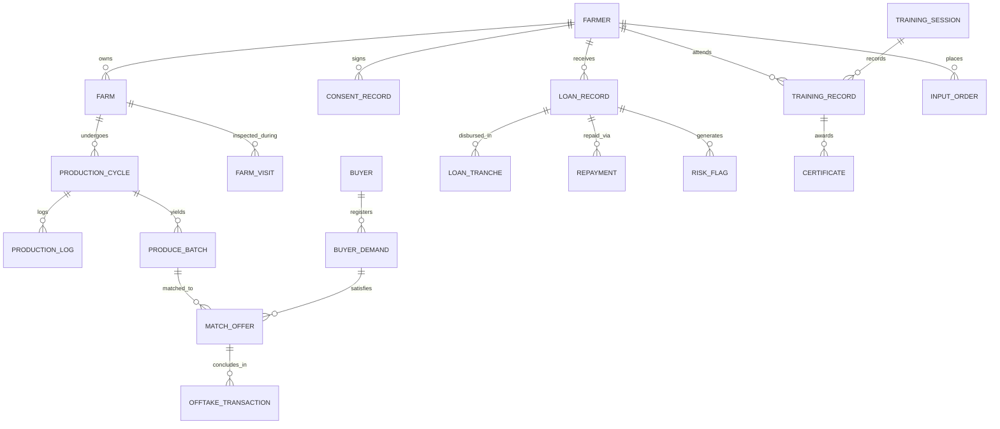
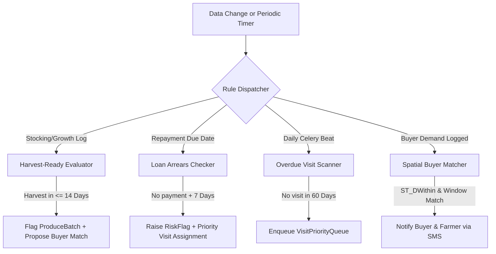
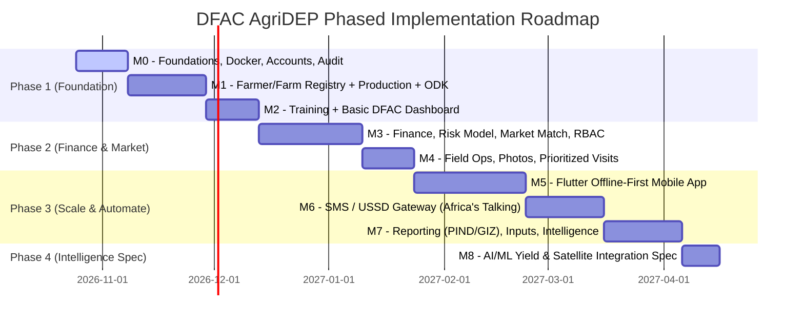

# DFAC AgriDEP (Agricultural Data Ecosystem Platform)
## Comprehensive Technical Implementation Plan & Architectural Blueprint

**Version:** 1.0  
**Date:** October 2026  
**Status:** Approved for Implementation (Milestone M0 & M1 Initiation)  
**Target Environment:** Doctor Fish Agricultural Consult (DFAC), Rural Niger Delta, Nigeria  

---

### Table of Contents
1. [Executive Summary & Operational Context](#1-executive-summary--operational-context)
2. [Technology Stack Confirmation & Architectural Decisions](#2-technology-stack-confirmation--architectural-decisions)
3. [Domain Architecture & Repository Structure](#3-domain-architecture--repository-structure)
4. [Data Model Specification & Entity Relationship Architecture](#4-data-model-specification--entity-relationship-architecture)
5. [Decision Automation Rules Engine & Algorithmic Workflows](#5-decision-automation-rules-engine--algorithmic-workflows)
6. [Role-Based Access Control (RBAC), Row Scoping & NDPA Compliance](#6-role-based-access-control-rbac-row-scoping--ndpa-compliance)
7. [Offline-First Synchronization Protocol & Data Ingestion](#7-offline-first-synchronization-protocol--data-ingestion)
8. [Phased Milestone Delivery Roadmap (M0 through M8)](#8-phased-milestone-delivery-roadmap-m0-through-m8)
9. [Quality Assurance, Testing Matrix & Definition of Done](#9-quality-assurance-testing-matrix--definition-of-done)
10. [Assumptions & Grouped Clarification Questions](#10-assumptions--grouped-clarification-questions)
11. [Immediate Sprint Execution: Milestones M0 & M1](#11-immediate-sprint-execution-milestones-m0--m1)

---

## 1. Executive Summary & Operational Context

Doctor Fish Agricultural Consult (DFAC) coordinates an agricultural ecosystem spanning aquaculture (primarily catfish, tilapia), snail farming, poultry, and arable crop value chains across the Niger Delta (Delta, Bayelsa, Rivers states). Today, stakeholders operate in fragmented silos: field notes on paper, training attendance in disparate spreadsheets, loan ledgers with individual lenders, and informal off-take agreements.

**DFAC AgriDEP** transforms this operational model by establishing a **single source of truth** anchored on three identity entities: **Farmer**, **Farm**, and **Buyer**. Data is captured once at the point of activity (field, training centre, or loan desk) and routed automatically to all authorized participants. 

### Core Non-Negotiable Tenets
1. **Decision-Driven, Not Form-Driven:** The system automatically answers operational imperatives: which farms require emergency field visits, which loan tranches are at risk based on biometric pond logs, and which harvest volumes match incoming buyer contracts.
2. **Offline-First Field Reality:** Connectivity in rural Delta, Bayelsa, and Rivers is unstable. Field operations must function completely disconnected, persisting records locally and syncing idempotently via delta protocols upon reconnection.
3. **Strict RBAC & Tenant/Row Scoping:** Data isolation is enforced at the database/ORM layer (`services.py` and `ScopedQuerySetMixin`), never solely in presentation templates. Buyers never see loan balances; lenders never inspect competing portfolios; unconfirmed buyers see anonymized producer pools.
4. **Nigeria Data Protection Act (NDPA 2023) Compliance:** Explicit per-stakeholder consent is captured at registration. National Identification Numbers (NIN) and phone numbers are encrypted at rest using field-level cryptography. Financial reads and state mutations generate immutable audit logs.
5. **Low-Bandwidth UX:** Web portals must load under 150 KB, render via server-driven HTML (HTMX + Alpine.js + Tailwind CSS), format currency in Nigerian Naira (`₦`), use `Africa/Lagos` timestamps, and support progressive migration to USSD/SMS for feature-phone farmers.

---

## 2. Technology Stack Confirmation & Architectural Decisions

To satisfy the non-negotiable operational requirements, the following production-grade stack is confirmed:

| Architectural Concern | Selected Technology | Technical Rationale & Implementation Details |
|---|---|---|
| **Core Framework** | **Python 3.12+ / Django 5.x LTS** | Mature ecosystem, native ORM spatial support, rock-solid migrations, proven security posture. |
| **API Framework** | **Django REST Framework (DRF) 3.15+** | Versioned RESTful API (`/api/v1/`), clean serialization, custom permission pipelines. |
| **API Documentation** | **drf-spectacular (OpenAPI 3.0)** | Auto-generated, strictly typed OpenAPI schema for mobile, partner, and third-party integrations. |
| **Spatial Database** | **PostgreSQL 16 + PostGIS 3.4** | Enterprise relational reliability. `django.contrib.gis` (GeoDjango) for spatial queries (`PointField`, `PolygonField`, `ST_DWithin` spatial indexing). |
| **Background Processing** | **Celery 5.4 + Celery Beat + Redis 7** | Asynchronous task execution: decision-rule evaluations, harvest-window recalculations, PDF/Excel generation, SMS dispatch. |
| **Web Presentation** | **Django Templates + HTMX + Alpine.js + Tailwind CSS** | Server-side rendered hypermedia. Eliminates heavy SPA JavaScript bundles. Sub-150KB pages with lightning-fast load times on 2G/3G networks. |
| **Mobile Capture (Field)** | **Kobo/ODK (M1–M4) $\rightarrow$ Flutter + Drift SQLite (M5)** | Immediate field capture via ODK REST webhook ingestion; followed by dedicated Flutter app with local Drift ORM, client-generated UUIDs, outbox queue, and delta sync. |
| **Farmer Outreach** | **Africa's Talking Gateway (SMS/USSD/OTP)** | Industry standard in Nigeria. Pluggable adapter architecture with `MockSMSProvider` and `ConsoleUSSDProvider` for automated testing and local dev. |
| **Storage & Media** | **S3-compatible (django-storages) / MinIO** | Geotagged inspection photos, signed certificates, and exported audit reports. MinIO for local Docker development. |
| **Reporting Engines** | **openpyxl & WeasyPrint** | Headless PDF generation for certificates and donor dossiers (PIND/GIZ format); streaming Excel exports for DFAC finance and lenders. |
| **Security & Privacy** | **django-cryptography / Fernet + django-auditlog** | Field-level encryption for sensitive PII (NIN, bank accounts). Immutable audit trail (`AuditEvent`) for all financial operations. |
| **Containerization** | **Docker & Docker Compose** | Reproducible multi-container stack (`web`, `postgres`, `redis`, `celery_worker`, `celery_beat`, `minio`). |

---

## 3. Domain Architecture & Repository Structure

AgriDEP is structured as a **modular monolith**. Each bounded context lives in its own Django application within `apps/`. Business logic is strictly encapsulated in `services.py`, `selectors.py`, and `rules/` sub-packages. Views and serializers remain lightweight validation and routing shells.

```
dfac-agridep/
├── .github/
│   └── workflows/ci.yml             # GitHub Actions: Ruff, Mypy, Pytest, Migration checks
├── agridep/
│   ├── config/                      # Core project configuration
│   │   ├── settings/
│   │   │   ├── base.py              # Common settings, apps, middleware, PostGIS config
│   │   │   ├── local.py             # Local dev settings (MinIO, Console SMS, Debug toolbar)
│   │   │   └── production.py        # Hardened production settings (AWS, SSL, Sentry)
│   │   ├── asgi.py
│   │   ├── celery.py                # Celery app initialization and beat scheduler
│   │   ├── urls.py                  # Root URL router (/api/v1/, /portal/, /admin/)
│   │   └── wsgi.py
│   ├── apps/
│   │   ├── common/                  # Base models, custom mixins, audit fields, PostGIS utils
│   │   ├── accounts/                # Custom User, Roles, SMS OTP authentication, NDPA Consent
│   │   ├── registry/                # Core identity anchors: Farmer, Farm, Buyer, Stakeholders
│   │   ├── production/              # ProductionCycle, ProductionLog, WaterQuality, HarvestForecast
│   │   ├── training/                # TrainingProgramme, Session, Attendance, Assessment, Certificate
│   │   ├── finance/                 # LoanApplication, LoanRecord, Tranches, Repayments, Risk scoring
│   │   ├── inputs/                  # Supplier directory, InputOrder, delivery tranche gates
│   │   ├── market/                  # BuyerDemand, CommodityPrice, Match algorithm, OfftakeTransaction
│   │   ├── fieldops/                # FarmVisit, Inspection, IncidentReport, PrioritizedVisitQueue
│   │   ├── alerts/                  # Decision rule definitions, Alert models, notification dispatcher
│   │   ├── reporting/               # KPI aggregations, donor report generators (PIND/GIZ), exports
│   │   ├── sync/                    # Delta sync engine (push/pull endpoints) & Kobo/ODK ingest
│   │   └── audit/                   # AuditEvent model and sensitive data access interceptors
│   ├── templates/                   # Base layouts and role-scoped HTMX templates
│   │   ├── layouts/base.html
│   │   ├── portals/
│   │   │   ├── dfac/                # DFAC management operational cockpit
│   │   │   ├── field_officer/       # Extension agent inspection & farmer roster views
│   │   │   ├── trainer/             # Attendance entry & competency scoring
│   │   │   ├── lender/              # Portfolio risk monitoring & disbursement control
│   │   │   └── buyer/               # Anonymized supply forecasts & contract confirmation
│   └── static/                      # Compiled Tailwind CSS and Alpine.js assets
├── docker/
│   ├── Dockerfile                   # Multi-stage Python 3.12 + GDAL/GEOS build
│   ├── docker-compose.yml           # Complete local development composition
│   └── entrypoint.sh               # Migration runner, static collection, server boot
├── docs/
│   ├── architecture.md              # Architectural Design Records (ADRs)
│   ├── data-dictionary.md           # Field-by-field schema reference
│   ├── rules.md                     # Comprehensive decision-workflow rule definitions
│   ├── api.md                       # OpenAPI reference and integration documentation
│   └── demo/                        # End-to-end demonstration scripts per milestone
├── tests/                           # Global integration and permissions matrix test suites
├── Makefile                         # Developer commands (run, test, lint, migrate, seed)
├── requirements.txt                 # Pinned Python dependencies
└── README.md                        # Quickstart and operational guidelines
```

---

## 4. Data Model Specification & Entity Relationship Architecture

### 4.1 Identity Anchors & Core Entity Relationships



### 4.2 Detailed Data Dictionary by Bounded Context

#### A. Common Base Model (`apps.common.models.TimeStampedUUIDModel`)
Every transactional table inherits:
- `id`: `UUIDField` (Primary Key, default `uuid.uuid4`, editable=False).
- `reference_code`: `CharField(max_length=32, unique=True, db_index=True)` (e.g. `DFAC-FRM-001042`).
- `created_at`: `DateTimeField(auto_now_add=True, db_index=True)`.
- `updated_at`: `DateTimeField(auto_now=True, db_index=True)`.
- `created_by`: `ForeignKey(User, null=True, on_delete=SET_NULL)`.
- `is_deleted`: `BooleanField(default=False, db_index=True)` (Soft delete).
- `client_id`: `UUIDField(null=True, blank=True, db_index=True)` (Offline deduplication key).
- `client_updated_at`: `DateTimeField(null=True, blank=True)` (Offline timestamp).

#### B. Accounts & Identity (`apps.accounts`)
- **`User`**: Extends `AbstractUser`. Stores `phone_number` (unique, E.164 format, indexed), `email`, `role` (`ENUM`: `DFAC_ADMIN`, `FIELD_OFFICER`, `TRAINER`, `LENDER`, `BUYER`, `FARMER`), `is_phone_verified`.
- **`ConsentRecord`**: NDPA 2023 compliance. Links `farmer`, `stakeholder_type` (`LENDER`, `BUYER`, `GOVERNMENT`, `RESEARCH`), `consent_given` (Boolean), `consent_scope` (Text), `channel` (`USSD`, `WRITTEN_FORM`, `APP_SIGNATURE`), `timestamp`.
- **`OTPToken`**: Phone verification token with 5-minute expiry, rate-limited attempts (max 3).

#### C. Registry (`apps.registry`)
- **`Farmer`**: Anchor entity.
  - PII: `first_name`, `last_name`, `phone_encrypted` (Fernet), `nin_encrypted` (Fernet, deterministic hash for duplicate indexing), `nin_hash` (`SHA-256`), `gender`, `dob`, `household_size`, `primary_language`.
  - Geo-Scope: `state` (Delta, Bayelsa, Rivers, etc.), `lga`, `community_address`.
  - Assignment: `cohort` (ForeignKey to `Cohort`), `assigned_officer` (ForeignKey to `User`).
  - Flags: `is_verified`, `verification_status` (`PENDING`, `VERIFIED`, `FLAGGED_DUPLICATE`).
- **`Farm`**: Anchor entity.
  - Relations: `farmer` (ForeignKey to `Farmer`, `related_name="farms"`).
  - Spatial: `location` (`PointField(srid=4326)`), `boundary` (`PolygonField(srid=4326, null=True)`), `total_area_hectares`.
  - Infrastructure: `water_source` (`BOREHOLE`, `RIVER`, `WELL`), `number_of_ponds`, `total_water_surface_sqm`, `soil_type`.
  - Enterprise Config: `enterprise_types` (`ManyToManyField` to `EnterpriseType`).
- **`EnterpriseType`**: Configurable database entity (`CATFISH`, `TILAPIA`, `SNAIL`, `POULTRY`, `CASSAVA`, `MAIZE`). Contains average cycle days, standard mortality benchmark %, and feeding conversion ratio (FCR) baselines.
- **`Buyer`**: Anchor entity. `company_name`, `rc_number`, `contact_person`, `phone`, `email`, `address`, `tier` (`AGGREGATOR`, `PROCESSOR`, `EXPORTER`, `RETAILER`).
- **`Lender`**: `institution_name`, `lender_type` (`MFI`, `COMMERCIAL_BANK`, `DONOR_FACILITY`), `contact_person`, `phone`.
- **`Supplier`**: `company_name`, `category` (`FEED`, `FINGERLINGS`, `FERTILIZER`, `MEDICATION`), `verification_status`.

#### D. Production (`apps.production`)
- **`ProductionCycle`**:
  - `farm` (FK), `enterprise_type` (FK), `cycle_name`, `start_date`, `projected_harvest_date`, `status` (`PREPARATION`, `STOCKED`, `GROWING`, `HARVEST_READY`, `HARVESTED`, `ABORTED`).
  - Capacity: `initial_stock_count`, `stocking_density_per_sqm`, `fingerling_average_weight_g`.
- **`ProductionLog`**:
  - `cycle` (FK), `log_date`, `sampling_average_weight_g`, `observed_mortality_count`, `feed_consumed_kg`, `feed_type`.
  - Water Parameters: `water_temperature_c`, `ph_level`, `dissolved_oxygen_ppm`, `ammonia_level`.
  - Photos: `inspection_photo` (ForeignKey to `MediaAttachment`).
  - Flags: `disease_symptoms_observed` (Boolean), `notes`.
- **`ProduceBatch`**:
  - `cycle` (FK), `farm` (FK), `produce_type` (FK), `projected_volume_kg`, `actual_volume_kg`, `projected_harvest_window_start`, `projected_harvest_window_end`, `quality_grade` (`GRADE_A`, `GRADE_B`, `GRADE_C`), `status` (`FORECASTED`, `AVAILABLE`, `MATCHED`, `DELIVERED`).

#### E. Finance & Loan Monitoring (`apps.finance`)
- **`LoanRecord`**:
  - `farmer` (FK), `lender` (FK), `facility_name`, `principal_amount_naira`, `interest_rate_percent`, `tenure_months`, `disbursement_date`, `status` (`APPLIED`, `APPROVED`, `DISBURSED`, `PERFORMING`, `WATCHLIST`, `DELINQUENT`, `REPAID`, `WRITTEN_OFF`).
  - Linked Cycle: `linked_production_cycle` (OneToOne to `ProductionCycle`, null=True).
- **`LoanTranche`**: `loan` (FK), `tranche_number`, `amount_naira`, `scheduled_disbursement_date`, `condition_type` (`DATE`, `INPUT_DELIVERY_CONFIRMATION`, `CYCLE_STAGE`), `is_released`, `release_date`.
- **`RepaymentSchedule`**: `loan` (FK), `installment_number`, `due_date`, `expected_amount_naira`, `paid_amount_naira`, `status` (`PENDING`, `PARTIAL`, `PAID`, `OVERDUE`).
- **`RiskFlag`**: `loan` (FK), `flag_type` (`MORTALITY_SPIKE`, `HARVEST_VOLUME_DROP`, `PAYMENT_OVERDUE`, `VISIT_DEFICIT`), `severity` (`LOW`, `MEDIUM`, `HIGH`, `CRITICAL`), `details`, `is_resolved`, `resolved_at`.

#### F. Market Linkage (`apps.market`)
- **`BuyerDemand`**:
  - `buyer` (FK), `enterprise_type` (FK), `desired_volume_kg`, `minimum_grade`, `target_delivery_window_start`, `target_delivery_window_end`, `delivery_location` (`PointField`), `max_delivery_radius_km`, `offered_price_per_kg_naira`, `status` (`OPEN`, `PARTIALLY_FILLED`, `FULFILLED`, `EXPIRED`).
- **`ProduceMatch`**:
  - `buyer_demand` (FK), `produce_batch` (FK), `allocated_volume_kg`, `agreed_price_per_kg_naira`, `status` (`PROPOSED`, `ACCEPTED_BY_BUYER`, `CONFIRMED_BY_FARMER`, `CONTRACTED`, `DECLINED`, `FULFILLED`).
- **`OfftakeTransaction`**:
  - `match` (OneToOne to `ProduceMatch`), `actual_delivered_volume_kg`, `actual_price_per_kg_naira`, `total_amount_naira`, `delivery_date`, `payment_status` (`PENDING`, `PAID_ESCROW`, `PAID_FARMER`), `waybill_number`, `quality_inspector` (FK to `User`).

#### G. Training & Capacity Building (`apps.training`)
- **`TrainingProgramme`**: `title`, `curriculum_code`, `target_enterprise` (FK), `duration_days`, `passing_score_percent`.
- **`TrainingSession`**: `programme` (FK), `trainer` (FK to `User`), `location_name`, `start_date`, `end_date`, `status` (`SCHEDULED`, `IN_PROGRESS`, `COMPLETED`).
- **`TrainingRecord`**: `session` (FK), `farmer` (FK), `attendance_rate_percent`, `pre_test_score`, `post_test_score`, `is_passed`.
- **`Certificate`**: `training_record` (OneToOne), `certificate_code`, `issue_date`, `expiry_date` (typically 24 months), `pdf_file`.

#### H. Field Operations (`apps.fieldops`)
- **`FarmVisit`**: `farm` (FK), `officer` (FK to `User`), `visit_type` (`ROUTINE`, `EMERGENCY_RISK`, `LOAN_VERIFICATION`, `HARVEST_INSPECTION`), `scheduled_date`, `check_in_timestamp`, `check_out_timestamp`, `check_in_location` (`PointField`), `findings_summary`, `follow_up_required` (Boolean).
- **`VisitAssignment`**: Generated by the rules engine. `farm` (FK), `assigned_officer` (FK), `trigger_reason` (`OVERDUE_60_DAYS`, `HIGH_RISK_FLAG`, `HARVEST_VERIFICATION`), `priority_score` (Integer), `deadline_date`, `status` (`PENDING`, `ACKNOWLEDGED`, `COMPLETED`, `CANCELLED`).

---

## 5. Decision Automation Rules Engine & Algorithmic Workflows

AgriDEP’s central value proposition is automated decision routing. Rules are implemented in `apps/alerts/rules/` as pure, testable Python functions. They are evaluated synchronously on state mutations (via domain services) and asynchronously via nightly Celery Beat sweeps.



### 5.1 Formalized Rule Specifications

| Rule ID | Trigger Event | Evaluation Logic / Condition | Automated Action | Recipients |
|---|---|---|---|---|
| **RULE-01** | Production Log Added | `projected_harvest_date - TODAY <= 14 days` and `batch.status == FORECASTED` | Transition batch to `AVAILABLE`. Run `match_produce_to_demands()`. | Field Officer, Matched Buyer(s) |
| **RULE-02** | Nightly Schedule (00:00 Lagos) | `repayment.due_date < TODAY - 7 days` and `repayment.status == PENDING` | Create `RiskFlag(severity=HIGH)`. Transition Loan to `DELINQUENT`. Create urgent `VisitAssignment`. | Lender, Assigned Field Officer, DFAC Finance |
| **RULE-03** | Production Log Added | `actual_weight_g < (expected_benchmark_weight * 0.75)` (25%+ yield deficit) | Flag `RiskFlag(severity=MEDIUM)`. Recompute `HarvestForecast`. Alert loan monitor. | Lender, Field Officer |
| **RULE-04** | Buyer Demand Registered | PostGIS spatial match: `ST_DWithin(farm.location, demand.location, max_radius)` within harvest window $\pm 7$ days | Generate `ProduceMatch(status=PROPOSED)`. Dispatch notification. | Buyer, Farmer (via SMS/Officer) |
| **RULE-05** | Loan Application Submitted | Farmer holds valid, non-expired `Certificate` in the enterprise type | Add $+15$ points to transparent credit scoring model. | Lender Portal |
| **RULE-06** | Nightly Schedule (01:00 Lagos) | `farm.last_visited_date < TODAY - 60 days` | Push farm into `VisitPriorityQueue` with baseline score $= 50$. | Field Officer, Field Coordinator |
| **RULE-07** | Nightly Schedule (02:00 Lagos) | `certificate.expiry_date - TODAY <= 30 days` | Dispatch renewal advisory SMS and enqueues retraining lead. | Farmer, Training Coordinator |
| **RULE-08** | Input Order Stage Gate | Loan tranche $N+1$ pending release while `InputOrder(tranche=N).delivery_confirmed == False` | Hard block on tranche release. Log compliance incident. | Lender, DFAC Finance |

### 5.2 Algorithmic Specifications

#### 1. PostGIS Buyer-Demand Matching Algorithm (`services.matching`)
Solves: *"Buyer needs $X$ tonnes of catfish in Delta State by Month $Y$."*
```python
def find_matching_produce(buyer_demand: BuyerDemand) -> List[ProduceBatch]:
    """
    Finds and ranks candidate produce batches using PostGIS spatial indexing,
    harvest delivery windows, and quality grade thresholds.
    """
    buffer_days = timedelta(days=7)
    window_start = buyer_demand.target_delivery_window_start - buffer_days
    window_end = buyer_demand.target_delivery_window_end + buffer_days

    candidate_batches = ProduceBatch.objects.filter(
        produce_type=buyer_demand.enterprise_type,
        status__in=['FORECASTED', 'AVAILABLE'],
        quality_grade__lte=buyer_demand.minimum_grade,
        projected_harvest_window_start__gte=window_start,
        projected_harvest_window_end__lte=window_end,
        farm__location__distance_lte=(
            buyer_demand.delivery_location,
            Distance(km=buyer_demand.max_delivery_radius_km)
        )
    ).annotate(
        distance=Distance('farm__location', buyer_demand.delivery_location)
    ).order_by('projected_harvest_window_start', 'distance')

    return candidate_batches
```

#### 2. Transparent Loan Expected-Value & Risk Model
Formula verified with the framework example (₦200,000 loan against ₦850,000 expected harvest):
$$\text{Expected Harvest Value} = \text{Projected Harvest Volume (kg)} \times \text{Reference Commodity Price (₦/kg)}$$
$$\text{Coverage Ratio} = \frac{\text{Expected Harvest Value}}{\text{Outstanding Loan Principal + Interest}}$$
- **Normal Operating Range:** $\text{Coverage Ratio} \ge 2.5$ (e.g. $\frac{₦850,000}{₦200,000} = 4.25$).
- **Early-Warning Trigger:** If mortality or sub-optimal growth reduces projected harvest such that $\text{Coverage Ratio} < 1.75$, trigger `RiskFlag(severity=MEDIUM)`.
- **Default Risk Trigger:** If $\text{Coverage Ratio} < 1.2$, trigger `RiskFlag(severity=CRITICAL)` and halt subsequent loan tranches.

#### 3. Field Officer Prioritized Visit Ranking Algorithm
Each active farm receives a dynamic priority score evaluated nightly:
$$\text{Priority Score} = w_1 \cdot \min(\text{DaysSinceVisit}, 90) + w_2 \cdot \text{RiskPoints} + w_3 \cdot \text{HarvestDaysScore} + w_4 \cdot \text{IncidentPoints}$$
- $w_1 = 1.0$ (Overdue visits: 1 pt per day past 30 days).
- $w_2 = 25.0$ per active `RiskFlag` (Critical = 50 pts, High = 30 pts, Med = 15 pts).
- $w_3 = 40.0$ if projected harvest is within 10 days (requires pre-harvest quality check).
- $w_4 = 30.0$ for unresolved disease/mortality incidents.

---

## 6. Role-Based Access Control (RBAC), Row Scoping & NDPA Compliance

### 6.1 Permission Access Matrix

| Resource / Model | Farmer | Field Officer | Trainer | Lender | Buyer | DFAC Admin |
|---|---|---|---|---|---|---|
| **Farmer PII (Name, NIN, Phone)** | Own Record | Assigned Cohort Only | Trainees in Session | Financed Farmers Only | **Masked** (Until Match Confirmed) | Full Access (Audited) |
| **Farm / GIS Data** | Own Farm | Assigned Cohort Only | View Only (if Trainee) | Financed Farms | Aggregated Region Only | Full Access |
| **Production Logs** | Own Logs | Assigned Cohort (CRUD) | No Access | Financed Farmers (Read) | No Access | Full Access |
| **Training & Certificates** | Own Records | Assigned Cohort (Read) | Assigned Sessions (CRUD)| Verified Status (Read) | Verified Status (Read) | Full Access |
| **Loans & Repayments** | Own Status | No Access | **DENIED (404/403)** | Own Portfolio Only | **DENIED (404/403)** | Full Access (Audited) |
| **Buyer Demands & Prices** | Price Alerts | View Regional Demands | No Access | View Regional Prices | Own Demands (CRUD) | Full Access |
| **Offtake Transactions** | Own Matches | Assigned Cohort Matches | No Access | Linked Financed Matches | Own Contracts Only | Full Access |
| **Audit Logs** | No Access | No Access | No Access | No Access | No Access | Full Access |

### 6.2 Architectural Implementation: `ScopedQuerySetMixin`
To guarantee that queries cannot leak data across tenants or roles, viewsets inherit from a central scoping mixin:

```python
class ScopedQuerySetMixin:
    """
    Enforces row-level isolation based on the authenticated user's role.
    If an external role accesses a record outside its relationship,
    return 404 (Object Not Found), preventing ID enumeration.
    """
    def get_queryset(self):
        user = self.request.user
        qs = super().get_queryset()
        
        if user.is_superuser or user.role == UserRole.DFAC_ADMIN:
            return qs

        if user.role == UserRole.FIELD_OFFICER:
            return qs.filter(cohort__in=user.assigned_cohorts.all())

        if user.role == UserRole.LENDER:
            return qs.filter(lender=user.lender_profile)

        if user.role == UserRole.BUYER:
            return qs.filter(buyer=user.buyer_profile)

        if user.role == UserRole.FARMER:
            return qs.filter(farmer=user.farmer_profile)

        return qs.none()
```

### 6.3 NDPA 2023 Compliance & Field-Level Encryption
1. **PII Encryption at Rest:** `nin_encrypted` and `phone_encrypted` are stored using symmetric AES-256-GCM / Fernet encryption keys managed via environment variables. Deterministic SHA-256 hashes (`nin_hash`) allow duplicate checks without decrypting table columns.
2. **Read Audit Logging:** Reads of sensitive financial details or bulk farmer PII are explicitly intercepted by middleware/services and committed to `apps.audit.models.AuditEvent`:
   - `actor`: User ID
   - `event_type`: `SENSITIVE_PII_READ`, `FINANCIAL_DISBURSEMENT_READ`
   - `target_model`, `target_id`, `ip_address`, `timestamp`

---

## 7. Offline-First Synchronization Protocol & Data Ingestion

### 7.1 Phase 1 Ingestion: KoboToolbox / ODK Aggregate Bridge
Before Milestone M5 (Flutter native mobile build), field officers register farmers and logs using KoboToolbox / ODK Collect forms on Android.
- **Webhook Receiver:** `POST /api/v1/sync/kobo-webhook/`
- **Validation Pipeline:** Ingests raw JSON/XML, validates NIN/Phone formatting, runs duplicate detection, creates `Farmer` and `ProductionLog` records, and stores the raw submission payload in `apps.sync.models.IngestionLog` for auditability.

### 7.2 Milestone M5: Dedicated Offline Sync Protocol
The Flutter app interacts with Django through an idempotent outbox delta protocol:

```
Mobile App (Drift SQLite)                      Backend API (Django + PostGIS)
        |                                                    |
        |--- 1. POST /api/v1/sync/push (Batched Outbox) ---->| Validate & Save in Transaction
        |    Payload: [{client_id, table, data, op_id}]      | Detect Conflicts
        |<-- 2. Response: {synced_ids, conflicts: []} -------| Return Acknowledgment
        |                                                    |
        |--- 3. GET /api/v1/sync/pull?since=<cursor> ------->| Scope Query by Officer Cohort
        |<-- 4. Response: {records: [...], tombstones: []} --| Return Incremental Changes
```

### 7.3 Conflict Resolution Matrix
- **Financial / Loan Data:** **Server-Wins**. Financial records can never be mutated offline by field devices.
- **Production Logs & Observations:** **Last-Write-Wins (Timestamp-based)** with conflict retention in `ConflictLog`. Both versions are preserved for DFAC data audit.
- **Client UUID Generation:** All offline-creatable entities generate standard RFC 4122 UUIDv4 keys on the device. Primary keys never collide during batch push operations.
- **Media / Photos:** Photos are excluded from the JSON payload. They are queued separately in the mobile client's media outbox and uploaded via resumable multi-part endpoints (`POST /api/v1/media/upload/`), referencing the parent entity's `client_id`.

---

## 8. Phased Milestone Delivery Roadmap (M0 through M8)



### Detailed Milestone Breakdown

#### Milestone M0: Platform Foundations & Scaffolding
- **Deliverables:**
  - Production-ready Docker Compose environment (PostgreSQL 16 + PostGIS, Redis 7, Python 3.12, Celery, MinIO).
  - Django project layout with split settings (`base.py`, `local.py`, `production.py`).
  - Base models (`TimeStampedUUIDModel`, soft deletes, `reference_code` generation).
  - Custom `User` model, role-based authorization hierarchy, NDPA `ConsentRecord`.
  - Field-level encryption utilities for PII (`cryptography` / Fernet).
  - Central `AuditEvent` tracking engine.
  - drf-spectacular OpenAPI 3.0 schema generation at `/api/v1/schema/`.
  - Seed framework (`make seed`) generating baseline roles, administrative boundaries (Niger Delta LGAs), and enterprise configurations.
  - CI pipeline (`.github/workflows/ci.yml`) enforcing Ruff linting, Mypy, and Pytest.

#### Milestone M1: Farmer & Farm Registry + Production Monitoring (Phase 1 Core)
- **Deliverables:**
  - Full registry models: `Farmer`, `Farm`, `EnterpriseType`, `Cohort`.
  - Duplicate-farmer detection engine (Phone match, NIN hash match, Levenshtein fuzzy name match + spatial radius $\le 500\text{m}$).
  - PostGIS geometry configuration (`PointField` for homesteads/ponds, `PolygonField` for farm plots).
  - Production models: `ProductionCycle`, `ProductionLog`, `WaterQuality`, `HarvestForecast`.
  - KoboToolbox / ODK Collect webhook ingestion endpoint with automated validation.
  - Lightweight field officer web portal (HTMX) for online farmer registration and cycle logging.
  - Test suite covering duplicate-detection edge cases and spatial boundary validation.

#### Milestone M2: Training Capacity Building & DFAC Operational Dashboard (Phase 1)
- **Deliverables:**
  - `TrainingProgramme`, `TrainingSession`, `Attendance`, `Assessment`, `Certificate`.
  - Automated certificate PDF generator (WeasyPrint) with verification QR code.
  - Bulk attendance importer supporting legacy CSV and Excel formats.
  - DFAC Management Operational Cockpit: Leaflet-based spatial map of registered farms, farmer counts, cycle stages, and pending duplicate reviews.

#### Milestone M3: Finance & Market Linkage Modules (Phase 2 Core)
- **Deliverables:**
  - `LoanRecord`, `LoanTranche`, `RepaymentSchedule`, `Repayment`, `RiskFlag`.
  - Expected-value and risk calculation service (₦200,000 loan vs ₦850,000 harvest model).
  - `BuyerDemand`, `ProduceBatch`, `ProduceMatch`, `OfftakeTransaction`.
  - PostGIS spatial matching engine (`ST_DWithin` radius + harvest window ranking).
  - Role-scoped web portals for Lenders (loan book, production tracking, risk flags) and Buyers (anonymized produce supply, demand registration, match confirmations).
  - Hardened permissions matrix and field-masking serializers.

#### Milestone M4: Field Operations & Inspection Management (Phase 2)
- **Deliverables:**
  - `FarmVisit`, `Inspection`, `IncidentReport`, `VisitAssignment`.
  - Geotagged inspection photo upload pipeline linked to S3/MinIO.
  - Dynamic `VisitPriorityQueue` ranking algorithm (scoring overdue visits, active disease flags, and financial delinquency).
  - Field officer HTMX daily inspection interface.

#### Milestone M5: Flutter Offline Mobile Application
- **Deliverables:**
  - Android-first Flutter app targeting low-end devices ($< 2\text{GB}$ RAM).
  - Local Drift SQLite database with client-side UUID generation.
  - Bidirectional Delta Sync Engine (`POST /api/v1/sync/push`, `GET /api/v1/sync/pull`).
  - Resumable background media upload queue.
  - Offline farmer registration, production logs, and visit checklist.

#### Milestone M6: SMS & USSD Farmer Engagement Channel (Phase 3)
- **Deliverables:**
  - Africa's Talking integration adapter (`apps.alerts.adapters`).
  - Farmer USSD session menu: Check loan balance, report weekly catfish mortality/weight, view market prices, accept buyer matches.
  - Transactional SMS alerts for harvest readiness, payment dues, and emergency weather/disease notices.
  - SMS OTP authentication for passwordless web/mobile farmer access.

#### Milestone M7: Reporting, Inputs & Market Intelligence (Phase 3)
- **Deliverables:**
  - Automated donor report generation (PIND/GIZ M&E indicators) in PDF and Excel.
  - `InputSupplier` directory, `InputOrder` workflows, and delivery confirmation tranche gates.
  - Commodity market price index tracking regional pricing trends across Niger Delta hubs.
  - Multi-season credit score calculation engine.

#### Milestone M8: Advanced Intelligence Extension Architecture (Phase 4 - Design Only)
- **Deliverables:**
  - Architectural blueprint for predictive ML yield models.
  - Integration interface specifications for Sentinel-2 satellite imagery (NDVI, pond surface water detection) and ECMWF weather APIs.
  - Multi-buyer cooperative pool matching design specifications.

---

## 9. Quality Assurance, Testing Matrix & Definition of Done

### 9.1 Testing Strategy & Mandatory Coverage
AgriDEP requires **$\ge 80\%$ test coverage** across all business rules, calculations, and permission boundaries.

```
Testing Pyramid:
  ▲
 / \  E2E Milestone Demos (docs/demo/m*_demo.sh)
/---\ Integration & Permissions Matrix (Role x Resource x Action)
/-----\ Core Services & Decision Rules (rules/, services.py)
/-------\ Unit Tests (Models, Validators, Encryption, Deduplication)
```

1. **Explicit Permission Matrix Test Suite (`tests/test_permissions_matrix.py`):**
   - Assert `403 Forbidden` or `404 Not Found` when a Buyer queries `/api/v1/finance/loans/`.
   - Assert Lender A receives `404 Not Found` when requesting `/api/v1/finance/loans/{id_lender_b}/`.
   - Assert Buyer receives sanitized JSON with `farmer_name: "ANONYMIZED"` prior to `ProduceMatch.CONFIRMED`.
   - Assert Trainer receives `403 Forbidden` when attempting to access farm financial balances.
2. **Decision Workflow Tests (`tests/test_rules_engine.py`):**
   - Assert that an overdue repayment triggers both a `RiskFlag` and a `VisitAssignment`.
   - Assert that an unconfirmed input order blocks release of subsequent loan tranches.
   - Assert that PostGIS matching returns farmers within the buyer's requested radius and delivery window.

### 9.2 Definition of Done (Per Milestone)
Every milestone must satisfy all criteria before moving to the next:
- [ ] `docker compose up` starts all services cleanly without manual intervention.
- [ ] `make test` runs pytest with $100\%$ green passing tests and $\ge 80\%$ coverage on rules and permissions.
- [ ] `ruff check .` and `mypy agridep` pass without errors.
- [ ] Migrations apply cleanly to an empty database and execute reversibly (`migrate <app> zero` tested).
- [ ] `make seed` successfully populates realistic Niger Delta demo data.
- [ ] OpenAPI schema `/api/v1/schema/` updates with zero schema generation warnings.
- [ ] Interactive demo script in `docs/demo/` executes from end to end without failure.

---

## 10. Assumptions & Grouped Clarification Questions

In accordance with Section 12.1 of the Build Prompt, the following are the explicit architectural assumptions and the grouped questions (maximum 8 questions across 4 themes). To maintain unblocked velocity, sensible default assumptions are adopted immediately:

### Group 1: Pilot Enterprise Scope & Geographic Coordinates
1. *Question:* What are the exact initial Local Government Areas (LGAs) and enterprise priority rankings for the Phase 1 pilot cohort in Delta, Bayelsa, and Rivers?
   - **Default Assumption Adopted:** We seed Delta (Warri South, Ughelli North), Bayelsa (Yenagoa, Ogbia), and Rivers (Obio-Akpor, Port Harcourt City), prioritizing **Catfish Aquaculture** as primary (80% of seed data), followed by **Cassava** and **Poultry**.
2. *Question:* For aquaculture ponds, will field officers capture GPS as a single point (homestead/main pond) or as multi-point polygons covering the water facility?
   - **Default Assumption Adopted:** The data model supports both: `Farm.location` (`PointField`) is mandatory for quick capture and radius matching; `Farm.boundary` (`PolygonField`) is optional for boundary mapping.

### Group 2: Identity Verification & PII Standards
3. *Question:* How should the platform treat farmers who lack an official Nigerian National Identification Number (NIN)?
   - **Default Assumption Adopted:** NIN is optional at initial registration to prevent exclusion of rural smallholders, but mandatory before a farmer can be approved for a formal `LoanRecord` or input financing. A temporary internal ID (`DFAC-TEMP-XXXXXX`) is generated in the interim.
4. *Question:* What specific fuzzy-matching threshold is preferred for duplicate-farmer detection?
   - **Default Assumption Adopted:** Exact match on normalized phone number (`E.164`) OR exact match on deterministic `nin_hash` raises an immediate duplicate warning; Levenshtein distance $\ge 85\%$ on full name combined with geographical proximity $\le 500\text{m}$ flags the record for manual review in DFAC Admin.

### Group 3: Financial & Tranche Release Rules
5. *Question:* Are loan disbursements paid directly in cash to the farmer, or paid in-kind to verified input suppliers?
   - **Default Assumption Adopted:** Mixed model. The platform defaults to in-kind input financing for initial tranches (paid directly to the supplier upon delivery confirmation), with secondary cash tranches for labor/operational expenses.
6. *Question:* In the event of a total crop/fish loss (force majeure like flooding in the Niger Delta), what is the exact loan status transition workflow?
   - **Default Assumption Adopted:** An `IncidentReport` marked as `FORCE_MAJEURE` verified by a Field Coordinator triggers a `RESTRUCTURE_PENDING` loan status, freezing interest accrual pending DFAC/Lender committee review.

### Group 4: Offline Synchronization Boundaries
7. *Question:* What is the maximum age of historical records synced down to an extension agent's mobile device during delta sync?
   - **Default Assumption Adopted:** Delta pull syncs the past 90 days of active cycles and visits for farms strictly within the officer's assigned cohort or LGA, preventing device memory exhaustion on low-end hardware.
8. *Question:* What is the fallback mechanism if SMS delivery fails for time-critical harvest alerts?
   - **Default Assumption Adopted:** SMS dispatch logs failures to `NotificationLog(status=FAILED)`. A Celery task retries up to 3 times before raising an in-app alert on the assigned Field Officer's dashboard to notify the farmer verbally.

---

## 11. Immediate Sprint Execution: Milestones M0 & M1

With the plan finalized, development begins strictly on **Milestone M0 (Foundations)** followed by **Milestone M1 (Registry + Production)**. Milestone M2 will not commence until M0 and M1 are fully verified and reviewed.

### Immediate Action Items for Milestone M0
1. **Repository & Tooling Scaffolding:**
   - Configure `.gitignore`, `Makefile`, `.env.example`, `ruff.toml`, and `.pre-commit-config.yaml`.
   - Create multi-stage `Dockerfile` (Python 3.12, GDAL, GEOS, PROJ) and `docker-compose.yml`.
2. **Django Core & Settings Architecture:**
   - Initialize Django project with split settings (`config/settings/base.py`, `local.py`, `production.py`).
   - Configure GeoDjango (`django.contrib.gis`) and PostgreSQL 16 + PostGIS connection.
   - Configure Redis, Celery, and Celery Beat schedule.
3. **Accounts, Roles & NDPA Models:**
   - Implement custom `User` with role choices, E.164 phone validator, and OTP models in `apps/accounts/`.
   - Implement `ConsentRecord` model for NDPA compliance.
   - Configure SimpleJWT for API authentication and standard sessions for web portals.
4. **Common Base & Audit Logging:**
   - Build `TimeStampedUUIDModel`, soft-delete manager, and reference code generator in `apps/common/`.
   - Implement symmetric field encryption for PII (NIN, Phone).
   - Configure `django-auditlog` and explicit `AuditEvent` model in `apps/audit/`.
5. **OpenAPI & Seed Framework:**
   - Configure `drf-spectacular` OpenAPI schema endpoints.
   - Write seed scripts (`agridep/apps/common/management/commands/seed_data.py`) providing initial administrative LGAs, enterprise types, and administrative superusers.
   - Verify green build with initial Pytest harness.

*(Proceeding to Milestone M1 immediately upon M0 completion: implementing Farmer & Farm registry models, duplicate detection engine, production cycles, and ODK/Kobo ingestion).*
